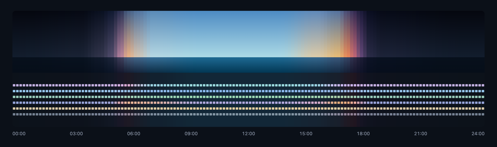
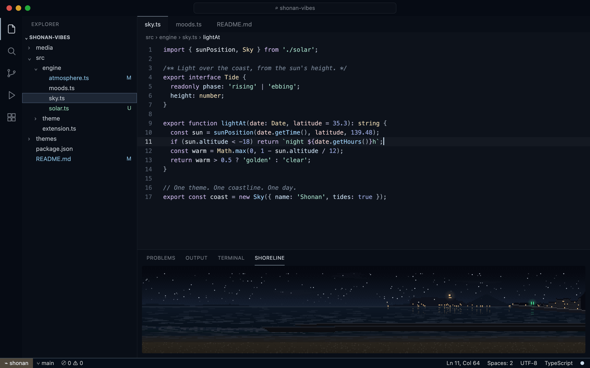
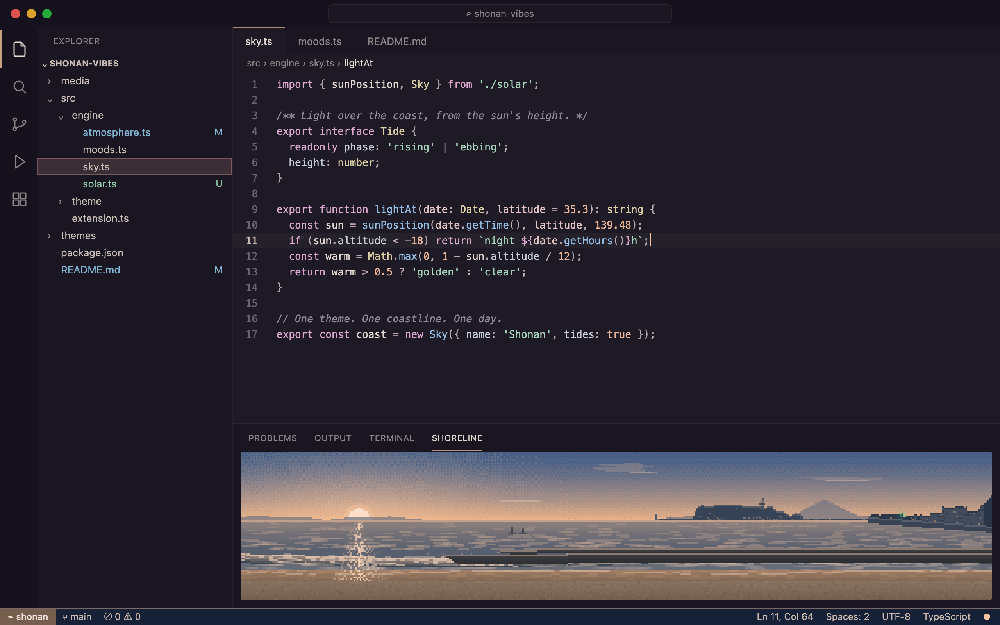
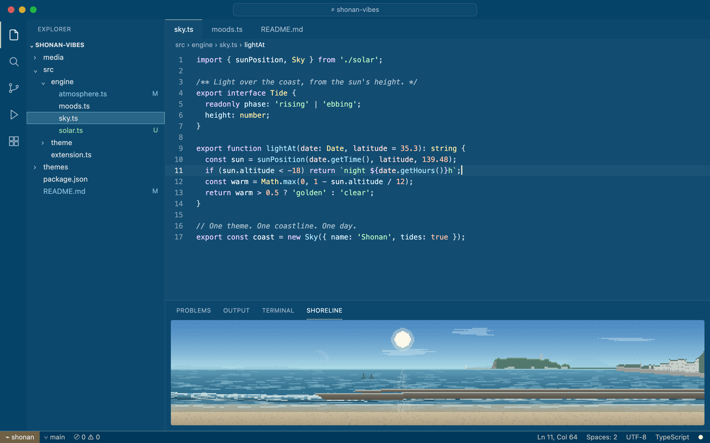
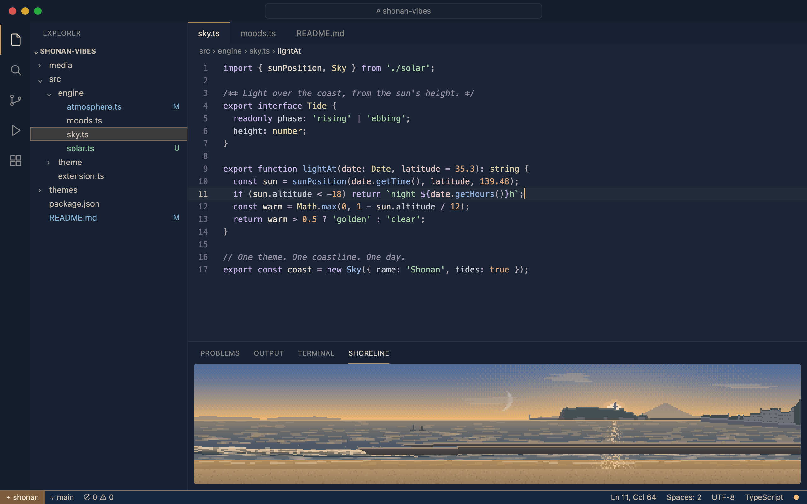
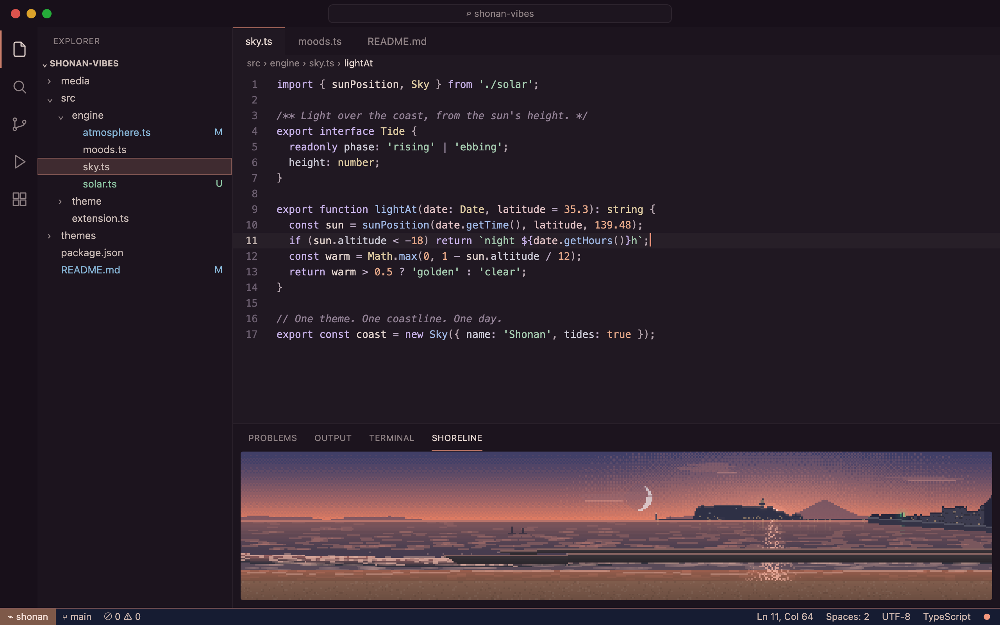
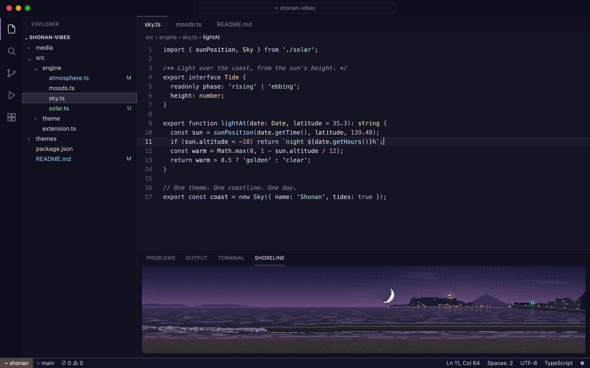
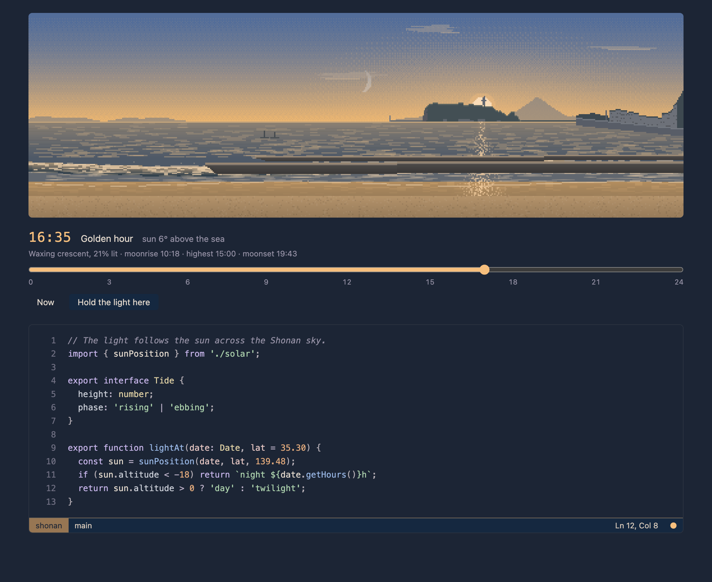

# Shonan Vibes

**One theme. One coastline. One day.**

A quiet theme for VS Code that follows the light of the Shonan coast. The colors move with the sun: moonlit navy after midnight, violet and pale pink at dawn, an open blue sky at noon, gold and coral at sunset, then back into the night. The changes are slow enough that you won't see them happen. You'll just notice, now and then, that the light is different.



*One day, Oct 15, as the theme sees it. Top: the coast. Bottom: the editor background with keyword, function, string, number, type and comment colors.*

## A day on the coast

| | |
|---|---|
|  |  |
| **01:40 · Night.** Black, navy, moonlight. | **05:52 · Sunrise.** Peach light enters the room. |
|  |  |
| **11:30 · Day.** An open blue sky; code floats on it in pale tints. | **16:35 · Golden hour.** The blue warms. |
|  |  |
| **17:06 · Sunset.** Coral on the horizon line. | **17:38 · Twilight.** Violet, then indigo. |

*Previews rendered from the theme's generated colors for Enoshima on Oct 15. The panel shows the Shoreline view.*

## What it is

- **Night is dark, noon is a blue sky.** After dark the editor is deep navy. Through the morning it opens into a clear sky blue, and the syntax colors become pale tints (lilac, ice blue, green, peach, sunlight yellow) that float on it. Text always stays light, so it never becomes a white light theme.
- **Driven by the sun, not the clock.** Shonan Vibes computes the sun's real altitude for today (NOAA algorithm, offline). So the June sunset at 18:58 and the December sunset at 16:32 get the same colors, at the right time.
- **Continuous.** There are no theme switches. Twelve moods (night, blue hour, dawn, sunrise, morning, day, afternoon, golden hour, sunset, afterglow, twilight, dusk) are blended continuously in OKLab, a perceptual color space, with easing. No color changes by more than half a just-noticeable difference per minute.
- **Stable meaning.** Keywords, functions, strings, numbers, types and comments each keep their color family all day; only the light falling on them changes. Numbers, for example, are a muted blue at night, soft peach at sunrise and soft orange at sunset.
- **Readable at every hour.** A contrast guard runs last on every color. Text stays at or above 9:1 in the dark hours and 7:1 under the midday sky, and every syntax color, comments included, stays at or above WCAG AA (4.5:1), for every hour of the year and every setting combination. The test suite checks this.
- **Calm.** Chroma is capped low. Nothing is neon, and there are no animations in the editor.

## The shoreline

The bottom of the window is treated as the coast:

- **Status bar = the sea.** It takes the ocean's color for the hour. Its top border is a thin horizon line in the color of the light: a faint silver thread at night, brighter at sunrise and sunset. The remote indicator at the far left sits on a strip of sand.
- **The light dot.** A small dot at the far right of the status bar takes the color of the current light: moon, dawn, sun or sunset. Hover it for the phase, the sun's height, and today's sunrise and sunset. Click it to open the Shoreline.
- **Shoreline view.** VS Code themes can only set solid colors, so the pixel-art coast lives in its own view (*Shoreline*, in the bottom panel). It is a panorama from the beach at Koshigoe, drawn after a photograph by the author: the low Miura peninsula to the east, the open sea to the south, Enoshima in its familiar outline (a sheer cliff, a broad wooded crown with the Sea Candle about two thirds across, a long slope to a small wooded hump, the yacht harbor and its little lighthouse), Fuji just beyond, and the Koshigoe shore with its green harbor light, behind concrete breakwaters. The sun and moon follow the real sky: they rise, cross and set at their true times and bearings. The moon shows its real phase for the day, with its lit side turned toward the sun, and keeps its real hours: a first quarter is highest in the evening, a full moon at midnight, a last quarter at dawn, about 50 minutes later each day. By day it is only a faint ghost, and near new moon it cannot be seen. The Shoreline tab and the light dot's tooltip list today's phase, moonrise, highest point and moonset. The stars wheel slowly across the sky through the night. It redraws only when the light changes. An optional, very slow shimmer runs only while the view is visible and respects reduced-motion settings.
- **Shoreline tab.** Run **Shonan Vibes: Open Shoreline** to scrub through today and preview any hour on a sample of code. Previewing doesn't touch your editor. **Hold the light here** keeps that hour until you choose **Follow the sun**.



## Getting started

1. Install **Shonan Vibes**.
2. Pick the theme: **Preferences: Color Theme** → **Shonan Vibes**.
3. That's it. The colors start following the sun over Shonan, mapped to your local hours.

Want it still? Set **Intensity** to `0` (static moonlit theme), or turn **Dynamic Colors** off.

## Settings

| Setting | Default | What it does |
|---|---|---|
| `shonanVibes.dynamicColors` | `true` | Follow the sun. Off: the static moonlit theme, with nothing written to your settings. |
| `shonanVibes.intensity` | `1` | How far the light moves: `0` static, `0.5` subtle, `1` the full day. |
| `shonanVibes.updateInterval` | `3` | Minutes between checks of the light. Colors are rewritten only when the change would be visible. |
| `shonanVibes.useLocalTime` | `true` | On: the coast is moved into your time zone, so its sunrise and sunset fall on your local hours. Off: the real-time sky over the configured coast. |
| `shonanVibes.sunriseTime` | `""` | Fixed sunrise, `HH:MM`. Empty uses today's real sunrise. |
| `shonanVibes.sunsetTime` | `""` | Fixed sunset, `HH:MM`. Empty uses today's real sunset. |
| `shonanVibes.oceanSaturation` | `1` | Color strength of sea, sky and accents, from `0` to `1.5`. Syntax colors are unaffected. |
| `shonanVibes.nightDarkness` | `0.5` | `0` gives soft slate nights, `1` near-black nights. |
| `shonanVibes.enableAtmosphericStatusBar` | `true` | Sea-colored status bar with horizon line and sand. Off gives a plain dark bar. |
| `shonanVibes.statusBarIndicator` | `true` | Show the light dot in the status bar. |
| `shonanVibes.seasonalTint` | `true` | Small seasonal shifts: livelier summer sea, cooler winter blue, pastel spring dawns, warmer autumn evenings. |
| `shonanVibes.fixedTime` | `""` | Hold the light at one time of day, `HH:MM`. |
| `shonanVibes.latitude` / `longitude` | Enoshima | The coast whose sun you follow. Set your own city to follow your own sky. |
| `shonanVibes.cloudCover` | `0` | Manual cloud cover from `0` to `1`. Mutes sky and sea; syntax colors stay the same. Reserved for a future, optional weather source. |
| `shonanVibes.shorelineMotion` | `true` | Slow shimmer on the water in the Shoreline view. |

## Commands

| Command | |
|---|---|
| **Shonan Vibes: Open Shoreline** | The coast in an editor tab, with a scrubber to preview any hour. |
| **Shonan Vibes: Hold the Light at a Time of Day…** | Lists today's actual times for each moment of light (for example, "Sunset · 17:07") and holds the one you pick. |
| **Shonan Vibes: Follow the Sun (Live)** | Release a held time. |
| **Shonan Vibes: Toggle Dynamic Colors** | Switch between the moving and the static theme. |
| **Shonan Vibes: Refresh Colors Now** | Recompute immediately, for example after waking the computer. |
| **Shonan Vibes: Remove Dynamic Colors from Settings** | Turn dynamic colors off and remove everything Shonan Vibes wrote. Run this before uninstalling. |

## How it works, and its limits

```
clock ─▶ sun altitude & direction ─▶ day phase ─▶ mood blend (OKLab) ─▶ season · clouds
       (NOAA, offline)              (altitude-based,   (12 keyframes,       ─▶ intensity · saturation · darkness
                                     rising ≠ setting)   eased)              ─▶ contrast guard ─▶ VS Code colors
```

| Part | Mechanism |
|---|---|
| **Theme** | A normal color theme file. It works on its own as the static moonlit base. |
| **Dynamic colors** | VS Code has no API for changing a theme at runtime. The supported way is user settings, so the extension writes `workbench.colorCustomizations`, `editor.tokenColorCustomizations` and `editor.semanticTokenColorCustomizations`, always under the theme-scoped key `"[Shonan Vibes]"`. Nothing leaks into other themes. Entries you add yourself inside that block are kept. |
| **Shoreline** | A webview view and panel. This is the only place graphics can live: themes cannot draw gradients or images in the status bar. |
| **Light dot** | A status bar item. Recoloring it costs nothing. |

How quiet is it?

- **Each check is cheap.** It computes about 600 colors in well under a millisecond.
- **Settings are written only when visible.** A write happens only when some color would change by at least half a just-noticeable difference. In a typical day that is about 90 updates, mostly around sunrise and sunset, and very few in deep night.
- **No other activity.** There is no animation in the editor, no network access and no telemetry.
- **Multiple windows agree.** Each window compares against what is already in settings, so they don't fight.

Notes:

- **Settings Sync.** If you use Settings Sync, these color updates sync too. To keep them on one machine, add the three settings above to `settings.sync.ignoredSettings`. That also stops syncing your own color customizations.
- **Startup.** VS Code shows the last written colors immediately. If the light has moved on since then, the colors adjust once, a moment after startup.
- **Uninstalling.** Run **Remove Dynamic Colors from Settings** first. If you forget, the leftover block is harmless, because it only applies to a theme that no longer exists.

## Development

Requires Node.js 20 or newer and VS Code 1.85 or newer.

```bash
npm install
npm run build              # compile and regenerate themes/shonan-vibes-color-theme.json
npm test                   # engine, contrast, continuity and settings-merge tests
npm run test:integration   # runs the extension inside VS Code with a throwaway profile
```

To try it live, open the folder in VS Code and press **F5** (**Run Shonan Vibes**). Use **Hold the Light at a Time of Day…** to jump through the day.

| Path | |
|---|---|
| `src/engine/` | Pure, dependency-free color engine: `color.ts` (OKLab, contrast), `solar.ts` (sun and moon), `sky.ts` (clock → sun, manual sunrise/sunset), `phase.ts` (sun → day phase), `moods.ts` (the palettes), `atmosphere.ts` (blending, modifiers, contrast guard) |
| `src/theme/` | `mapper.ts` (palette → VS Code colors and token rules), `overrides.ts` (how colors live in settings) |
| `src/*.ts` | The extension: controller, settings writer, status indicator, Shoreline webviews |
| `media/shoreline.js` | The pixel-art scene (plain canvas, no dependencies) |
| `scripts/` | Theme generator, preview renderer, integration runner |

Extending the engine:

- **Weather, season and other inputs** are `Modifier`s: `(palette, environment) => palette` in `atmosphere.ts`. A weather provider only needs to fill `cloudCover` (and new fields) in the `Environment`.
- **Sun model.** Anything that produces a `SunState` (altitude, direction, today's extremes) can replace the sun model.
- **Palette.** To change the look, edit `moods.ts`. The tests will tell you if a change breaks readability or continuity.

Regenerate the README previews with `npm run previews` (needs Google Chrome; set `CHROME=/path` if it is elsewhere).

## Packaging and publishing

1. README images are resolved from the GitHub repository in `package.json`, so it must stay public and pushed.
2. Package and try the build locally:
   ```bash
   npx vsce package                       # → shonan-vibes-0.1.0.vsix
   code --install-extension shonan-vibes-0.1.0.vsix
   ```
3. Publish (free):
   ```bash
   npx vsce login tsubasato              # Azure DevOps personal access token, scope: Marketplace › Manage
   npx vsce publish
   npx ovsx publish shonan-vibes-0.1.0.vsix -p <open-vsx-token>   # optional: Open VSX, for VSCodium and others
   ```

## Credits

- Solar position: the NOAA Solar Calculator algorithm (after Jean Meeus, *Astronomical Algorithms*).
- Color space: OKLab, by Björn Ottosson.
- Palettes and the Shoreline pixel art are original; the icon artwork is by the author.

## License

[MIT](LICENSE)
